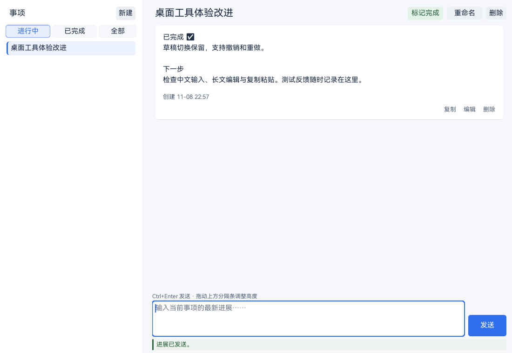

# Matterlog

Matterlog 是一个使用 Zig、DVUI 和 SQLite 编写的本地事项进展记录工具。

- **事项管理**：新建、选择、完成/重新打开、筛选、重命名、删除
- **进展记录**：新增、编辑、删除

## 界面预览



截图中的事项与进展均为占位内容，仅用于界面展示。

## 环境

- Zig 0.17.0
- DVUI 0.6.0-dev（`main@4189669`，由 `build.zig.zon` 锁定）
- translate-c 2.0.0（用于生成 C 绑定，由 `build.zig.zon` 锁定）
- SQLite 3.53.4（源码已放在 `vendor/sqlite`）
- 字体：HarmonyOS Sans SC（许可文件随构建产物安装）

首次构建需要联网下载 DVUI、translate-c 及其依赖，之后可以使用本地 Zig 缓存。

## 开发

```powershell
# 构建
zig build

# 运行
zig build run

# 测试
zig build test
```

- **快捷提交**：新增或编辑进展时按 `Ctrl + Enter`（macOS 为 `Cmd + Enter`）。
- **调整输入区**：上下拖动进展记录与输入框之间的分隔条，即可调整输入区高度。
- **快速编辑**：双击进展正文即可进入编辑。
- **取消操作**：重命名、编辑或删除确认时按 `Esc`，未发送的进展草稿不会被清空。
- **Windows 系统托盘**：点击窗口关闭按钮或按 `Alt + F4` 时隐藏到托盘，当前事项和未发送草稿会保留。点击或右键托盘图标，在菜单中选择“打开 Matterlog”恢复窗口，选择“退出”关闭程序。托盘初始化失败时仍按正常方式关闭窗口。
- **Windows 单实例**：重复启动会将已有窗口切到前台；窗口在托盘中或已最小化时会恢复显示，当前事项和草稿不变。

## 数据

应用通过 SDL 的用户偏好目录保存数据库。在 Windows 上通常是：

```text
%APPDATA%\Matterlog\matterlog.db
```

## Windows 可执行文件

已编译的 Windows x86_64 程序位于 `release/windows-x86_64/`。重新生成：

```powershell
.\release-windows.ps1
```

## 许可证

Matterlog 使用 [MIT License](LICENSE)。

## 源码结构

```text
src/main.zig                        DVUI/SDL 应用入口与主题
src/app_state.zig                   应用状态与业务动作
src/ui.zig                          界面布局与交互
src/tray.zig                        Windows 系统托盘与关闭隐藏
src/single_instance.zig             Windows 单实例与重复启动唤起
src/database.zig                    SQLite 数据访问
assets/                             PNG/ICO 图标、Windows 资源定义与 README 截图
assets/fonts/                       HarmonyOS Sans SC 与字体许可证
vendor/sqlite/                      SQLite amalgamation、版本与哈希
release/windows-x86_64/             Windows x86_64 发布文件
build.zig                           构建入口
release-windows.ps1                 Windows x86_64 发布脚本
LICENSE                             Matterlog MIT 许可证
```
